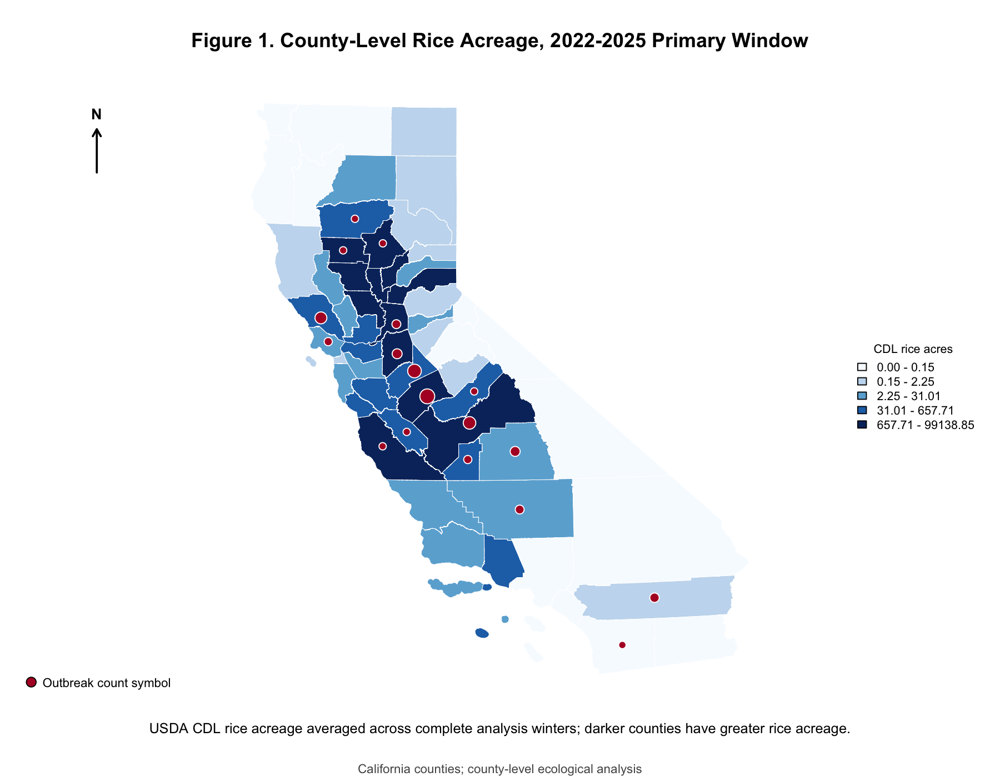

# From Fields to Flu: California H5N1 Disease Ecology

**Doctoral dissertation | R · spatial epidemiology · PRISM climate data · One Health · ArcGIS-compatible GIS**

Code supporting *From Fields to Flu: Mapping H5N1 Zoonotic Risk in California
Rice Fields* (PhD in Public Health, Epidemiology; Walden University, 2026).
This project integrates agricultural land cover, migratory waterfowl observations,
animal-health surveillance, and climate data to study the wildlife–agriculture
interface in California.

## Why I undertook this study

Winter-flooded rice fields provide surrogate wetland habitat for migratory
waterfowl along the Pacific Flyway. That conservation and agricultural landscape
also creates opportunities for wildlife and domestic animal systems to overlap.
My dissertation asked whether rice-field habitat, Snow Goose activity, and their
interaction were associated with reported poultry HPAI outbreaks, using a
One Health and disease-ecology framework.

The aim was to connect an ecological question to measurable surveillance and
environmental data, assess the evidence statistically, and communicate the
spatial patterns relevant to surveillance. Poultry outbreak incidence was the
measurable animal-health endpoint; human infection risk and individual
transmission pathways were outside the analysis.

## Research and technical contributions

| Capability | Evidence in this repository |
| --- | --- |
| Multi-source epidemiologic data integration | Harmonized USDA/APHIS surveillance, eBird checklist summaries, poultry census, land cover, and climate into county-winter analysis datasets |
| Climate and raster analysis | [PRISM extraction](scripts/build_prism_county_winter_from_tifs.R) using `terra`, `sf`, and `exactextractr`; county-level temperature and precipitation summaries |
| Environmental exposure construction | [CDL rice acreage extraction](scripts/build_cdl_rice_county_acres.R) and [DWR source comparison](scripts/build_dwr_rice_validation.R) |
| Statistical epidemiology | [Negative binomial and logistic models](scripts/dissertation_final_analysis.R), interaction testing, overdispersion checks, confidence intervals, and statewide sensitivity analyses |
| Spatial analysis and communication | County joins, residual Moran's I permutation diagnostic, descriptive spatial convergence overlays, GeoPackage export, and six map figures |
| Reproducible research | Scripted R workflow, prepared input snapshots, checksums, package-version records, and [checks against archived results](scripts/verify_reproduction.R) |

## Why these design and modeling choices?

| Choice | Rationale and interpretation |
| --- | --- |
| County-winter observational units | A common geographic and seasonal scale for joining public surveillance, bird observations, agriculture, and climate; direct farm-level exposure data were unavailable |
| November–February winters | Captures winter waterfowl activity; January–February belong to the preceding winter start year |
| Three complete analysis winters | 2022–2023, 2023–2024, and 2024–2025 align available complete bird summaries with the outbreak period; partial boundary winters are excluded from the primary analysis |
| Rice-producing primary sample | At least 1,000 CDL rice acres in any crop year 2022–2024 keeps the sample tied to the habitat question: 12 counties and 36 county-winters |
| Statewide sensitivity sample | All 58 California counties and 174 county-winters provide a broader comparison |
| Rice and Snow Goose proxies | Annual rice acreage represents potential habitat, not observed flooding; mean Snow Goose count per complete checklist represents observed activity, with checklist effort included as a covariate |
| Negative binomial regression | Addresses overdispersed outbreak counts; logistic models assess any reported outbreak as a secondary outcome |
| Spatial overlays alongside regression | Describe geographic overlap among habitat, wildlife, poultry exposure, and outbreaks while keeping descriptive patterns separate from adjusted associations |

The adjusted models include poultry inventory, checklist effort, winter
temperature, and precipitation. See [methods and limitations](docs/methods.md)
for model specifications, missing-value handling, suppression, and repeated
county observations.

## What the study found

The three focal primary negative binomial tests did not find statistically
significant adjusted associations:

| Research question | Rate ratio (95% CI) | p-value |
| --- | --- | --- |
| RQ1: rice acreage | 0.75 (0.45–1.25) | .271 |
| RQ2: Snow Goose activity | 1.10 (0.60–2.03) | .762 |
| RQ3: rice × Snow Goose interaction | 1.47 (0.57–3.82) | .426 |

The small primary sample and coarse exposure proxies limit what these null
results establish. Descriptive GIS overlays showed ecological and agricultural
overlap, motivating finer-scale habitat and movement measurements. This work
shows how to report uncertainty and distinguish plausible ecological mechanisms
from what the available data can support. Full results are in
[`results/reference/dissertation_analysis/`](results/reference/dissertation_analysis/).

## GIS and ArcGIS interoperability

**The analysis and maps are implemented in R using `sf`, `terra`, and related
packages.** The workflow exports **ArcGIS-compatible GeoPackage layers** for
further mapping in ArcGIS Pro or other GIS software; ArcGIS Pro is not required
and was not the software used to generate the analysis here.

- [Export spatial layers](scripts/export_arcgis_layers.R): county totals, winter-specific layers, and DWR/CDL validation layers.
- [Build spatial overlays](scripts/arcgis_dissertation_spatial_analysis.R): descriptive convergence scores and county-winter summaries.
- [Create map figures](scripts/create_arcgis_dissertation_visuals.R): six reproducible GIS figures.



*One example from the archived GIS outputs. Maps support ecological
interpretation and do not establish transmission pathways.*

## Run the analysis

From the repository root, with R installed:

```sh
Rscript scripts/install_dependencies.R
Rscript scripts/run_analysis.R
Rscript scripts/verify_reproduction.R
```

To include spatial layers and map figures:

```sh
Rscript scripts/run_analysis.R --spatial
```

The runner uses the included real-data county summaries and creates ignored
outputs under `analysis_outputs/`. The spatial option uses the archived DWR/CDL
comparison table. Large raw-data acquisition and raster processing are separate
stages documented in [the execution guide](docs/reproducing.md).

Local verification reproduced all 80 model-result rows, all 12 model-fit rows,
and the 406-row full dataset within numerical tolerance; all 12 models
converged. GIS generation also completed. See [verification details](docs/verification.md)
and [observed package versions](docs/r-package-versions.csv). R 4.6.0 was used;
spatial package installation may require GDAL, GEOS, PROJ, and build tools.

## Explore the repository

- [`scripts/`](scripts/): analysis, data preparation, and GIS workflows.
- [`data/prepared/`](data/prepared/): county-level input snapshots.
- [`results/reference/`](results/reference/): archived tables, maps, and analysis notes.
- [`docs/data-sources.md`](docs/data-sources.md): provenance and source coverage.
- [`source_manifest.csv`](source_manifest.csv): imported file paths and checksums.
- [`scripts/manuscript/`](scripts/manuscript/): optional historical document-editing code; excluded from the analysis runner and syntax-checked only.

The repository was assembled from the supplied analysis archive. The original
source materials remain unchanged. Raw flock-level exports, large rasters,
private manuscripts, dissertation PDFs, and chat transcripts are excluded.
Earlier exploratory notes are retained as development history; the final
analysis above defines the reported workflow.

## Related project and rights

The complementary [wildfire and H5N1 ML prototype](https://github.com/infectiousvibes/wildfire-h5n1-california)
explores county-grouped prediction and model interpretation using synthetic
data. This dissertation repository contains the observational analysis.

No open-source license has been selected for this code. Third-party datasets
retain their own terms; see [LICENSE-NOTICE.md](LICENSE-NOTICE.md).
